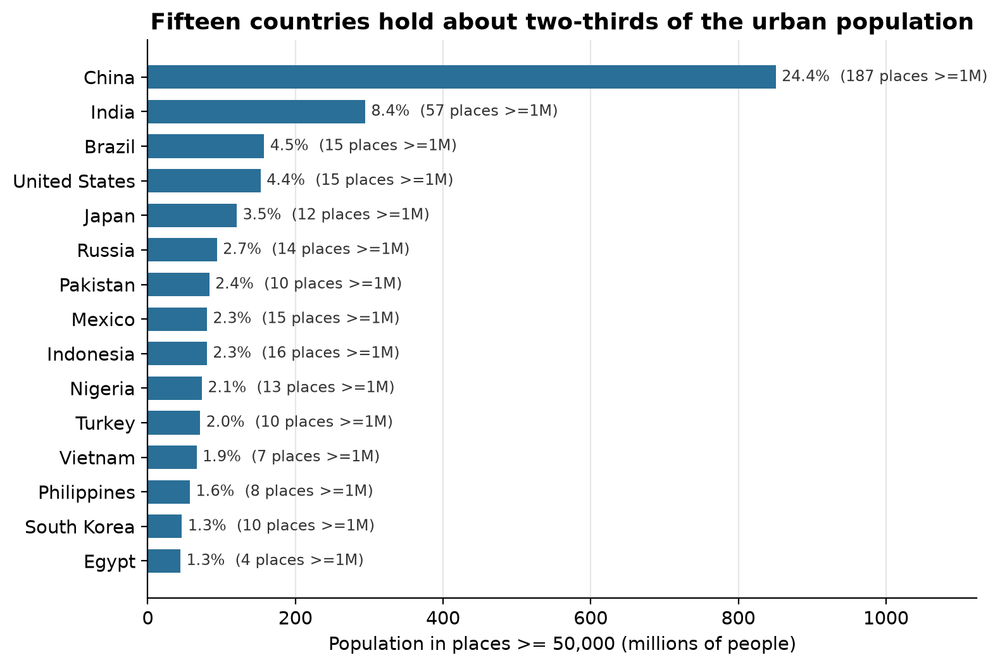
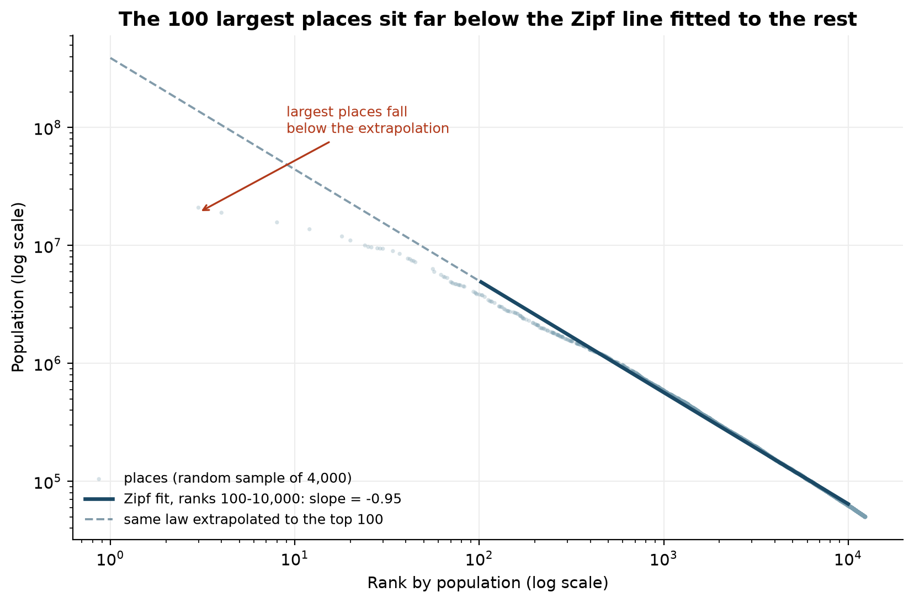

# LI YUQIAO

I am a master's student at the University of Macau (CISC7204, Data Science). I like questions that
can be answered with a dataset and a plot, and I care about making the answer reproducible: a
reader should be able to rerun my notebook and get the same numbers.

## Technical skills

* **Languages:** Python (pandas, numpy, matplotlib), SQL, a little R
* **Data work:** cleaning and deduplicating messy records, exploratory analysis, log-log and
  rank-size modelling, country-level aggregation
* **Visualisation:** matplotlib (publication-quality PNG/SVG), interactive maps and dashboards
* **Tooling:** Jupyter, git and GitHub, GitHub Pages, reproducible environments with `requirements.txt`

## Project showcase

### How Uneven Is the World's Urban Population?

**Research question.** If you rank the world's cities by population, how concentrated is urban
population in a few countries and a few very large cities, and does the size distribution follow
the rank-size ("Zipf") rule?

**Data.** GeoNames `cities15000` (CC BY 4.0), restricted to the 12,386 places above 50,000
inhabitants after cleaning: 3.49 billion people in 187 countries and territories.

**What the figure shows.** The 15 largest countries hold 65.1% of the covered population; China
alone accounts for 24.4%, more than India (8.4%), Brazil (4.5%) and the United States (4.4%)
together. Urban population is not spread evenly across countries - it is stacked in a handful.

**Second finding.** Ranks 100-10,000 follow a power law with slope -0.95, essentially the classic
Zipf value, but the 100 largest places sit an order of magnitude below the extrapolation of that
law. Cities under one million still hold 53.6% of the covered population.

**Limitation.** GeoNames mixes city-proper populations with urban districts for some countries and
only lists places above 15,000, so absolute counts are indicative rather than official, and the
single snapshot cannot show urban growth.

* **Project repository:** <https://github.com/KrisWarrenLi/data-science-project>
* **Status:** completed
* **Reproduce:** `pip install -r requirements.txt`, then run all cells of
  `notebooks/world_cities_analysis.ipynb`.

## What I am working on next

Adding a time dimension (two GeoNames snapshots, or World Bank urban-population series) so the
project can say something about growth instead of a single picture, and rebuilding the portfolio
with a small Hugo site once the analysis side is solid.
